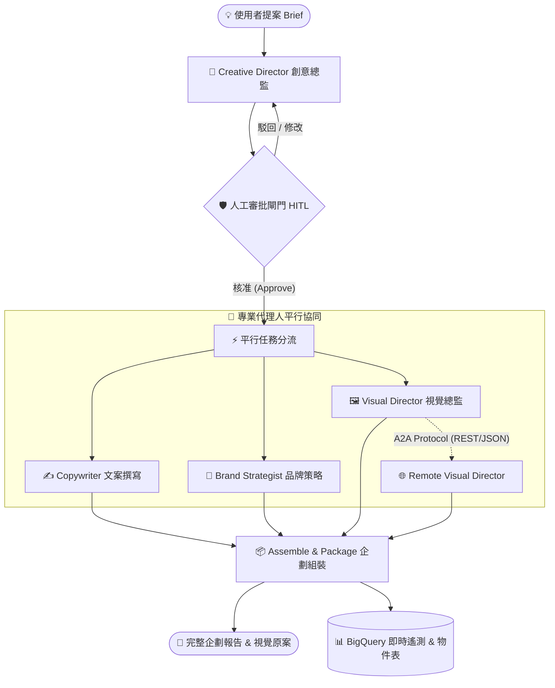

# Agentic Pitch Generator (Build with Gemini · Masterclass)

[](https://www.python.org/)
[](https://cloud.google.com/)
[](LICENSE)

An enterprise-grade multi-agent campaign pitch generator built on Google Cloud Vertex AI, Agent Development Kit (ADK), BigQuery Multimodal Analytics (`OBJ.MAKE_REF` / `AI.SCORE`), and Human-in-the-Loop (HITL) approval orchestration.

[繁體中文版說明 (Traditional Chinese)](#繁體中文版-traditional-chinese) | [English Documentation](#english-documentation)

---

## 繁體中文版 (Traditional Chinese)

### 🌟 專案概述與架構核心

**Agentic Pitch Generator** 是在 Google「*Build with Gemini: Agent Masterclass*」實戰演練中建構的企業級多代理人廣告企劃生成系統。系統透過模組化代理人協同作業，將使用者的模糊提案轉化為符合品牌規範（Brand-compliant）的廣告概念、文案、受眾策略、視覺設計圖與組裝提案。



---

### 🧠 核心技術與各模組實作歷程

本專案經過完整四個模組與多次真實生產環境調校：

#### Module 1: Specialist Agents, Skills & A2A 通訊
- **專家技能注入 (Skill-Augmented Visual Director)**：建立 `brand-guidelines/SKILL.md`，注入色系（深靛藍 Indigo、岩板灰 Slate、琥珀暖金 Amber）、單一低角度側逆光、三分法則與大面積留白等品牌標準。
- **單元評測 (Skill Evals)**：使用正負樣本進行語義評估，確保美術設計嚴格遵循品牌指南，自動杜絕霓虹色、浮水印及雜亂構圖。
- **Agent-to-Agent (A2A) 遠端協同**：實作 Agent Card 規格 (`/.well-known/agent-card.json`) 與 `RemoteA2aAgent`，讓主編排器透過標準化 REST 協議與獨立的視覺總監服務進行跨服務協作。

#### Module 2: BigQuery 多模態分析與閉環品牌飄移微調
- **BigQuery Object Tables (`OBJ.MAKE_REF` & `OBJ.FETCH_METADATA`)**：整合 Cloud Storage 與 BigQuery，在 SQL 中直接對 GCS 上的影像進行物件引用。
- **閉環評分 (`AI.SCORE`)**：透過 Gemini 評測影像與概念的品牌契合度（Brand Fit 1~10 分），若低於 7.0 則標記為需要重新產出（`needs another pass`）。
- **品牌飄移修復 (`detect_brand_drift` & `tune_prompt_and_skill`)**：自動分析違規類別（色系違規、燈光違規、排版違規），並以動態補償方式修正 Prompt。
- **即時遙測串流 (`BigQueryAnalyticsService`)**：即時將 session_id、agent 名稱、執行延遲 (latency)、Token 用量及完成狀態寫入 `bwg.agent_events` 資料表。

#### Module 3: 企業安全護欄、PII 去識別化與人工介入 (HITL)
- **PreToolUse 護欄勾點 (PreToolUse Hooks)**：在工具調用前攔截惡意字元、SQL/Prompt Injection 或未授權指令。
- **PII 敏感資訊過濾 (`scrub_pii`)**：以正規表達式自動脫敏真實姓名、電子郵件、電話號碼與信用卡號，防止隱私洩漏。
- **人工在環審批 (Human-in-the-Loop)**：在創意總監產出概念後暫停工作流程，等待使用者透過前端介面確認或修改後才放行平行分流代理人。

#### Module 4: 企業級 Tokenomics 成本與配額治理
- **Token 消耗與延遲監控 (`TokenomicsGuard`)**：追蹤每次任務的輸入、輸出 Token 以及執行耗時，計算各節點的資源消耗。
- **超額防護機制**：設定嚴格的階段配額與預算上限，超過閥值時觸發熔斷保護。

#### 🎨 視覺化前端體驗升級 (Frontend Redesign)
- **全繁體中文直覺化介面**：將原有除錯導向的英文面板徹底重構為高階商務儀表板。
- **可視化工作流路線圖**：清晰指示當前執行到哪一個階段（創意概念 $\to$ 人工審批 $\to$ 平行分流 $\to$ 組裝封裝）。
- **一鍵快捷提案靈感**：提供「雨都通勤單車」、「海洋環保跑鞋」、「貓咪飛行滑板」等測試範本。
- **A2A 協作透明度面板**：即時展示發起方、接收方、通訊協定與資料上下文。

---

### 🛠️ 快速開始與部署指南

#### 1. 前置需求
- Python 3.10+
- Google Cloud 專案（已啟用 Vertex AI API、BigQuery API、Cloud Storage）
- 已安裝 Google Cloud CLI (`gcloud`) 與 GitHub CLI (`gh`)

#### 2. 環境設定與安裝
```bash
# 複製儲存庫
git clone https://github.com/KeredStudio/agentic-pitch-generator.git
cd agentic-pitch-generator

# 建立並啟動虛擬環境
python3 -m venv .venv
source .venv/bin/activate

# 安裝相依套件
pip install -e .
```

#### 3. 設定環境變數 (`.env`)
複製 `.env.example` 並設定您的 Google Cloud 專案資訊：
```bash
cp .env.example .env
```
編輯 `.env`：
```env
PROJECT_ID="your-gcp-project-id"
REGION="asia-east1"
BIGQUERY_DATASET="bwg"
LOGS_BUCKET_NAME="your-gcp-project-id-bwg"
IMAGE_MODEL="imagen-3.0-generate-002"
TEXT_MODEL="gemini-2.5-flash"
```

#### 4. 初始化 Google Cloud 雲端資源
執行自動化設定腳本，建立 GCS 儲存庫、BigQuery 資料集與連線：
```bash
bash scripts/setup.sh
```

#### 5. 本地啟動伺服器與前端體驗
```bash
# 啟動 Web 伺服器 (Port 8080) 與 Visual Director A2A (Port 8801)
bash .agents/skills/start-frontend/scripts/start_server.sh restart

# 在瀏覽器開啟儀表板
# http://localhost:8080
```

#### 6. CLI 終端測試
亦可直接透過終端機執行代理人工作流程：
```bash
python3 call_agent.py "為夜間通勤族設計一款高反光防雨夾克"
```

#### 7. 部署至 Google Cloud Run
```bash
# 執行自動化部署腳本（會自動部署 Visual Director 與 Pitch Generator）
bash scripts/deploy.sh
```

---

## English Documentation

### 🌟 Project Overview & Architecture

**Agentic Pitch Generator** is an enterprise-grade multi-agent campaign generation platform developed during the Google "*Build with Gemini: Agent Masterclass*". It coordinates a team of specialized AI agents built on Google Cloud Vertex AI and the Agent Development Kit (ADK) to turn brief conceptual ideas into fully packaged, brand-compliant marketing campaigns.

### 🧩 System Architecture

- **Creative Director (`Agent`)**: Ideates high-level campaign concepts from user briefs.
- **Human-in-the-Loop Gate (HITL)**: Halts execution to solicit human review/approval before downstream asset generation.
- **Specialist Sub-Agents (Parallel Execution)**:
  - **Copywriter**: Creates punchy, high-conversion ad copy ($< 25$ words).
  - **Brand Strategist**: Identifies core target audiences and strategic positioning.
  - **Visual Director**: Translates campaign concepts into detailed art directions adhering to house brand skills.
  - **Remote Visual Director (A2A)**: Standalone microservice communicating via the Agent-to-Agent REST protocol.
- **Assembler & Packager**: Synthesizes all multimodal outputs into a unified campaign proposal.
- **BigQuery Analytics & Multimodal Tables**: Streams real-time telemetry into `bwg.agent_events` and scores visual assets against brand guidelines using `AI.SCORE` and `OBJ.MAKE_REF`.

---

### 🔬 Implementation Details by Module

| Module | Core Features | Key Technologies & Files |
| :--- | :--- | :--- |
| **Module 1** | Specialist Agents, Custom Skills, Eval Harness, Remote A2A | `brand-guidelines/SKILL.md`, `RemoteA2aAgent`, `/.well-known/agent-card.json` |
| **Module 2** | BigQuery Multimodal Analytics, Closed-Loop Brand Drift Remediation | `OBJ.MAKE_REF`, `OBJ.FETCH_METADATA`, `AI.SCORE`, `BigQueryAnalyticsService` |
| **Module 3** | PreToolUse Hooks, PII Redaction, Human-in-the-Loop Orchestration | Guardrails, Regex PII scrubbing (`scrub_pii`), Session state pausing |
| **Module 4** | Production Tokenomics Governance & Quota Throttling | Token & latency budgeting, `TokenomicsGuard`, Cloud Run ready |

---

### 🚀 Getting Started & Deployment

#### 1. Prerequisites
- Python 3.10 or newer
- Google Cloud Platform account with Vertex AI, BigQuery, and Cloud Storage enabled
- `gcloud` CLI and `gh` CLI installed

#### 2. Installation
```bash
git clone https://github.com/KeredStudio/agentic-pitch-generator.git
cd agentic-pitch-generator
python3 -m venv .venv
source .venv/bin/activate
pip install -e .
```

#### 3. Environment Configuration
```bash
cp .env.example .env
# Fill in your PROJECT_ID, REGION, and GCS Bucket information
```

#### 4. Provision Cloud Infrastructure
```bash
bash scripts/setup.sh
```

#### 5. Run Locally
```bash
# Start backend server & frontend UI on port 8080
bash .agents/skills/start-frontend/scripts/start_server.sh restart

# Open http://localhost:8080 in your browser
```

#### 6. Run Unit & Step Verification Tests
```bash
# Verify all lab modules
python3 .agents/skills/lab-helper/scripts/verify_workspace.py --step all

# Run unit tests
python3 -m unittest discover -s tests
```

#### 7. Deploy to Cloud Run
```bash
bash scripts/deploy.sh
```

---

### 📂 Repository Structure

```text
agentic-pitch-generator/
├── frontend/                     # Modern Traditional Chinese Web UI
│   ├── index.html                # Workflow roadmap, preset triggers & cards
│   ├── styles.css                # Dark-themed responsive styles
│   └── app.js                    # SSE streaming, HITL gate & A2A monitor
├── pitch_generator/              # Core Application Package
│   ├── agent.py                  # Agent definitions, workflow graph & HITL
│   ├── config.py                 # Environment & project configuration
│   ├── fast_api_app.py           # FastAPI REST API & SSE endpoints
│   ├── app_utils/                # Cloud service adapters & primitives
│   │   ├── services.py           # BigQueryAnalyticsService & Container
│   │   ├── runtime_clients.py    # Vertex AI & GCS client wrappers
│   │   ├── memory_bank.py        # Session state persistence
│   │   └── a2a.py                # Agent-to-Agent communication protocols
│   ├── skills/brand-guidelines/  # Visual brand guideline skill
│   └── sql/                      # BigQuery SQL (create_key_visuals, score_brand_fit)
├── scripts/
│   ├── setup.sh                  # Cloud resource provisioning
│   └── deploy.sh                 # Cloud Run deployment orchestrator
├── tests/                        # Comprehensive test suite for Modules 1–4
├── call_agent.py                 # CLI execution entry point
└── pyproject.toml                # Project package metadata & dependencies
```

---

### 📄 License
This project is licensed under the Apache 2.0 License - see the [LICENSE](LICENSE) file for details.
